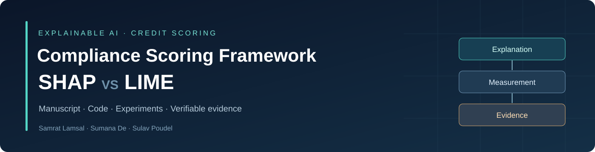
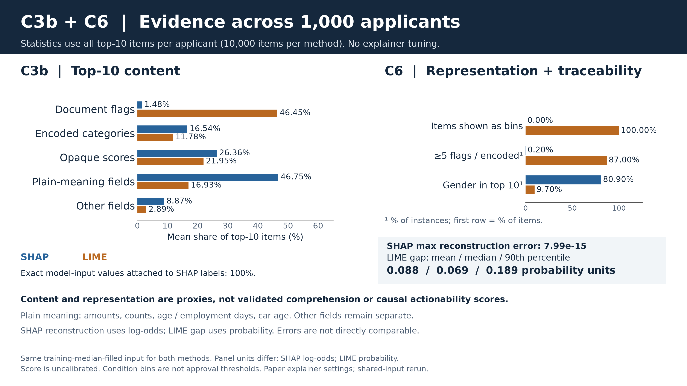
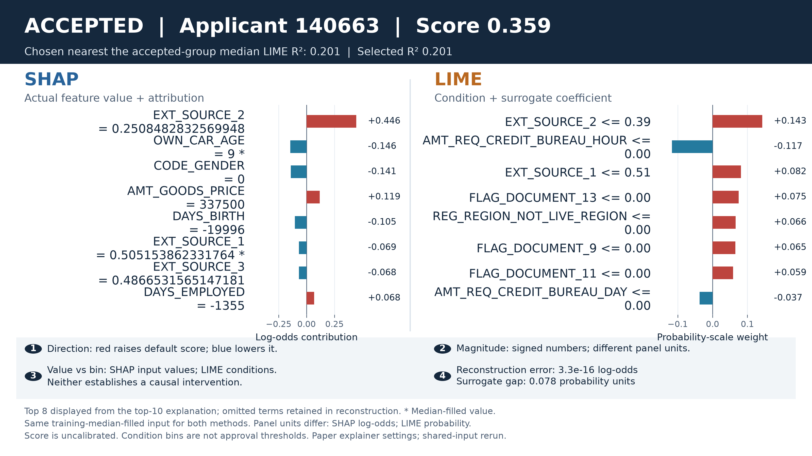
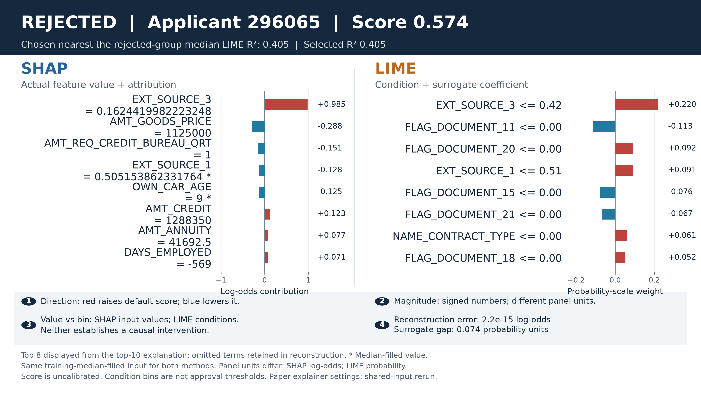

<p align="center"></p>

# Compliance Scoring Framework: SHAP VS LIME

[](verification/README.md)


**How do SHAP and LIME support transparency, human oversight, and auditability in credit scoring?** This research companion collects the manuscript, original evaluation code, supplemental corrections, figures, trained rerun models, and independently checkable explanation artifacts.

**Authors:** Samrat Lamsal · Sumana De · Sulav Poudel<br>
School of Computer Engineering, KIIT Deemed to be University

**[Read the paper](paper/Evaluating_SHAP_and_LIME_Against_EU_AI_Act_A.pdf)** · **[Reviewer guide](docs/REVIEWER_GUIDE.md)** · **[Reproduce](docs/REPRODUCIBILITY.md)** · **[Results & provenance](docs/RESULTS_AND_PROVENANCE.md)**

## Start here

| Your goal | Where to go |
|---|---|
| Understand the research question and CSF | [Six-page manuscript](paper/Evaluating_SHAP_and_LIME_Against_EU_AI_Act_A.pdf) and [methodology](docs/METHODOLOGY.md) |
| Trace a claim to its code and output | [Reviewer guide](docs/REVIEWER_GUIDE.md) |
| Inspect corrections and later experiments | [Results & provenance](docs/RESULTS_AND_PROVENANCE.md) |
| Check saved evidence without downloading the training dataset | [Quick verification](#verify-the-saved-evidence) |
| Train models or regenerate explanations | [Reproduction instructions](docs/REPRODUCIBILITY.md) |
| Inspect individual SHAP/LIME explanations | [Four applicant cases](output/applicant_comparisons/CASE_RESULTS.md) and [1,000-applicant results](output/paper_c3b_c6_evidence/RESULTS.md) |

## Research at a glance

The study uses **307,511 Home Credit loan applications**, compares Logistic Regression, Random Forest, and LightGBM, and evaluates explanations from the selected LightGBM model. The CSF has seven criteria; C3 is split into two components, giving **eight scored components**.

| Criterion | What is examined |
|---|---|
| C1 · Coverage / fidelity | SHAP top-feature attribution coverage; LIME local surrogate R² |
| C2 · Consistency | Repeatability of top-feature sets using Jaccard similarity |
| C3a · Structural complexity | Feature count, conditions, and label length |
| C3b · Comprehensibility | Author-assessed checklist; later content-proxy analysis |
| C4 · Bias detection | Gender attribution differences and feature visibility |
| C5 · Fairness transparency | Model-level approval-rate disparity |
| C6 · Oversight support | Explanation properties supporting human review |
| C7 · Auditability | Reproducibility and traceability requirements |

The mappings to EU AI Act articles are the paper's research operationalization. **CSF scores are not a legal compliance determination or validated human-comprehension scores.**

## Results, with their provenance

| Evidence track | SHAP | LIME | Interpretation |
|---|---:|---:|---|
| Selected manuscript: overall CSF | **4.12 / 5** | **2.50 / 5** | Values reported in the supplied paper |
| Supplemental C4 correction: overall CSF | **4.00 / 5** | **2.50 / 5** | Probability-space C4 changes SHAP's component score; other inputs include paper-reported values |
| Selected manuscript: stochastic consistency | **1.000** | **0.381** | Reported mean Jaccard |
| Corrected supplemental consistency rerun | **1.000** | **0.3734** | Newly computed; paired Wilcoxon p ≈ 3.90 × 10⁻¹⁸ |
| Later shared-input analysis: gender in top ten | **80.9%** | **9.7%** | 1,000 applicants, retrained model, identical median-filled inputs |

These are **different evidence tracks**, not interchangeable estimates from one run. The original fitted model was unavailable; later analyses use a 190-round retrained model rather than the original transcript's 204-round model. The paper's 100% SHAP gender availability is also different from gender appearing in a top-ten list. See [the provenance notes](docs/RESULTS_AND_PROVENANCE.md) before interpreting comparisons.

## Visual evidence

<p align="center"></p>

*Later shared-input analysis, not the original paper's experiment. SHAP reconstruction is checked in log-odds; LIME surrogate gaps are checked in probability-scale units. Their error magnitudes must not be compared as a ratio.*

<details>
<summary><strong>Open paired applicant examples</strong></summary>




“Accepted” and “rejected” describe model classifications at a 0.5 cutoff, not recorded lending decisions. These scores are not established calibrated default probabilities. See the [selection rules and limitations](output/paper_c3b_c6_evidence/README.md).

</details>

## Verify the saved evidence

Use Python 3.11. No Kaggle download is needed for these checks:

```bash
git clone https://github.com/Samrat17ab/Compliance-Scoring-Framework-SHAP-VS-LIME.git
cd Compliance-Scoring-Framework-SHAP-VS-LIME
python -m venv .venv
# Windows: .venv\Scripts\activate
# macOS/Linux: source .venv/bin/activate
python -m pip install -r requirements-verify.txt
python -m unittest discover -s tests -v
```

The tests check artifact hashes, the paper PDF, model predictions, SHAP additive reconstruction, explanation composition, automatic example selection, paired statistics, corrected score arithmetic, and Monte Carlo weighting. They **do not claim to rerun the full original training experiment**. A [GitHub Actions template](tools/github-actions-verify.yml) is included; hosted CI is not yet enabled because the publishing connection lacks workflow-write permission.

For a full experiment environment and dataset setup, see [REPRODUCIBILITY.md](docs/REPRODUCIBILITY.md). Run computational experiments in a separate clone because the original scripts write fixed output filenames.

## Repository map

```text
paper/                            Selected paper PDF and one earlier supplied PDF
paper_corrected.tex               Existing manuscript source (version caveats documented)
csf_evaluation.py                  Original end-to-end training/evaluation script
rerun_supplemental.py              Supplemental probability-space and sensitivity analyses
rerun_analysis_C_fix.py            Corrected stochastic consistency rerun
recompute_downstream.py            Corrected CSF arithmetic and weight sensitivity
supplemental_*.json                Saved supplemental numerical results
fig*.png / fig*.pdf                Saved paper/supplemental figures
output/applicant_comparisons/      Four paired cases, model, explanations, validation
output/paper_c3b_c6_evidence/       1,000-case evidence, arrays, model, visual summaries
archive/                          Original mixed code/output transcript and historical logs
docs/                             Methodology, reviewer guide, provenance, reproduction
tests/                            Independent artifact-verification tests
verification/                     Content hashes and recorded local verification
tools/                            Checksum utility and GitHub Actions setup template
```

Scientific scripts remain at the root to preserve their original relative paths. Figure scripts using hard-coded reported values are explicitly identified in the [reviewer guide](docs/REVIEWER_GUIDE.md).

## Data and use

Obtain `application_train.csv` from the [Home Credit Default Risk competition](https://www.kaggle.com/competitions/home-credit-default-risk/data). The full training table is **not redistributed** here. Saved explanation artifacts include a 1,000-row sample of transformed inputs, anonymized sample identifiers, and derived outputs for verification. Dataset terms continue to apply; see [DATA.md](docs/DATA.md).

No open-source license grant has been added to the supplied research materials. See [RIGHTS.md](RIGHTS.md). Citation metadata is available in [CITATION.cff](CITATION.cff); no publication venue or DOI is asserted.
