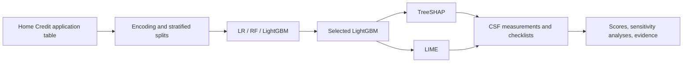

# Methodology overview

This page summarizes the supplied research implementation; it does not establish current legal requirements.

## Pipeline

## Data and modeling

- 307,511 rows; 122 columns including target and loan identifier.
- Drop `TARGET` and `SK_ID_CURR` from the model inputs, leaving 120 features.
- Label-encode string columns; drop only wholly missing columns.
- Seed-42 stratified 64% / 16% / 20% split: 196,806 training, 49,202 validation, 61,503 test rows.
- Compute numerical fill values from the training split. The historical code fits categorical vocabularies before splitting; this behavior is preserved and is not claimed to be a production preprocessing design.
- Compare Logistic Regression, Random Forest, and LightGBM; retain the paper's model-selection procedure unchanged.

## Explanation settings

The main analysis samples 1,000 test rows, displays ten features, and uses 1,000 LIME perturbations per explanation. Kernel-width sweeps and repeated-run checks use smaller samples. Exact parameters are in each script and the saved JSON.

TreeSHAP without a background dataset explains raw LightGBM margins in log-odds. LIME fits a local surrogate for the probability-scale output. Attribution coverage and surrogate R² are different measurements. The supplemental probability-space SHAP experiment uses interventional SHAP and a background sample, a different configuration from default TreeSHAP.

## Score construction

The eight components are C1, C2, C3a, C3b, C4, C5, C6, and C7. The overall score is their unweighted arithmetic mean. Quantitative conversion thresholds and qualitative checklist scores are research choices. Monte Carlo weight sensitivity explores alternative component weights; it does not validate the thresholds or checklist judgments.

The later shared-input analysis documents representation, content composition, and additive accounting. It supplies empirical proxies relevant to C3b/C6, without assigning new human-comprehension or oversight scores.

See [results and provenance](RESULTS_AND_PROVENANCE.md) for input-policy changes, missing original-model provenance, and scale limitations.
